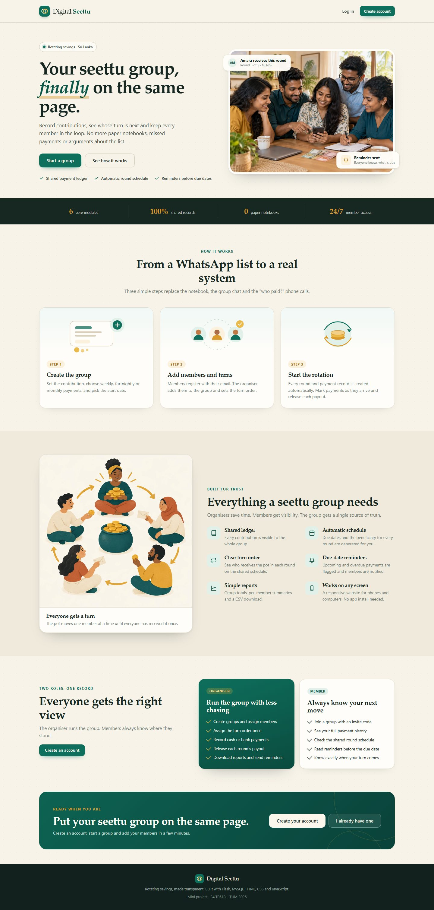
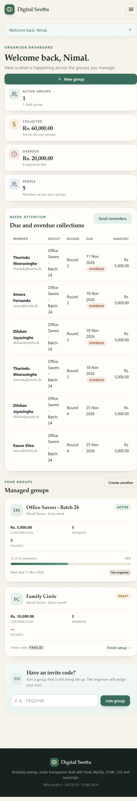
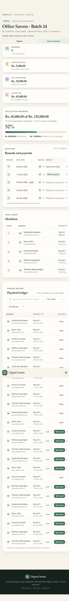
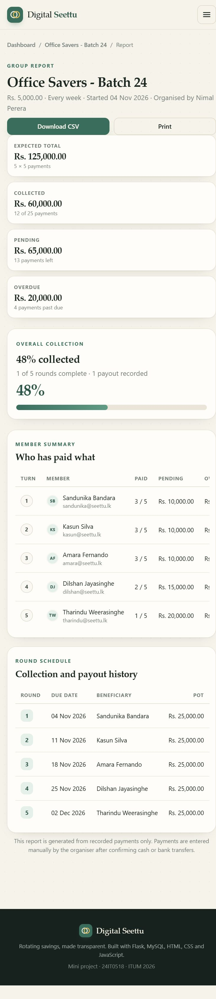
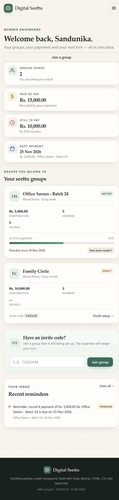
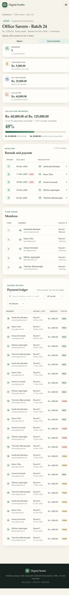

# Digital Seettu Management System

Mini project **24IT0518** — Diploma in Information Technology, Institute of Technology, University of Moratuwa.

A web application that replaces the paper notebook used to run a **seettu** (rotating savings group).
The organiser creates a group, adds members, assigns turn order, records contributions and releases payouts.
Every member can log in and see the same schedule, payment history and reminders.

Built with **Python (Flask) + MySQL + HTML/CSS/JavaScript**, as requested for this project.

---

## 1. What the system does

| Proposal requirement | Where it is implemented |
| --- | --- |
| Register and log in as organiser or member | `/register`, `/login` (`auth.py`, table `users`) |
| Create and manage a group (contribution, members, frequency) | `/groups/new`, `/groups/<id>` (`groups.py`, table `seettu_groups`) |
| Add members and assign turn order | Draft group page (`groups.py`, table `group_members`) |
| Record payments as paid / pending | Payment ledger with **Mark paid** / **Undo** (`groups.py`, table `payments`) |
| Shared payment history and group status visible to members | Group page + payment ledger visible to every member |
| Automatic reminders before due dates | Reminder engine (`services.create_reminders`), `/reminders`, `send_reminders.py` |
| Simple reports (payment summary, member history) | `/groups/<id>/report` + **Download CSV** |
| Group activity status | `draft → active → completed` group status, round status, overdue calculation |

The proposal's six modules map to the code like this:

| Module | Files |
| --- | --- |
| User | `auth.py`, `app.py` (session/guards), `services.py` (user functions) |
| Group | `groups.py` (`new`, `detail`, `start`, `delete`), `services.py` (group functions) |
| Member | `groups.py` (`add_member`, `save_turn_order`, `leave`), `group_members` table |
| Payment | `groups.py` (`mark_paid`, `mark_pending`, `mark_payout`), `payments`/`rounds` tables |
| Reminder | `dashboard.py`, `services.py` (reminder functions), `send_reminders.py` |
| Report | `groups.py` (`report`, `report_csv`), report template |

---

## 2. Screenshots

| Landing page | Organiser dashboard |
| --- | --- |
|  |  |

| Active group + payment ledger | Report + CSV |
| --- | --- |
|  |  |

| Member dashboard | Group view for members (read-only) |
| --- | --- |
|  |  |

> Screenshots were taken from a demo run. Invite codes change every time `seed_demo.py` is executed.

---

## 3. Technology used

- **Python 3.10+** with **Flask 3** (routing, sessions, Jinja2 templates)
- **MySQL / MariaDB** (XAMPP 10.4 is fine) — InnoDB tables with foreign keys
- **mysql-connector-python** for database access
- **HTML5 + Jinja2** templates, **CSS3** (custom design system, responsive), **vanilla JavaScript** (no framework)
- **Werkzeug** password hashing, `python-dotenv` for settings

No paid services, no external accounts and no internet connection are required for the demo.

---

## 4. Project structure

```
digital-seettu/
├── app.py                  Creates the Flask app, template filters, error pages, starts the server
├── config.py               Reads settings from .env (database, secret key, reminders, SMTP)
├── db.py                   One MySQL connection per request + query() / execute() helpers
├── auth.py                 Register, login, logout and the login/organiser guards
├── dashboard.py            Dashboard, "join with invite code", reminder routes
├── groups.py               Group setup, payments, payouts, report page + CSV download
├── services.py             All business logic and SQL (the "brain" of the app)
├── seed_demo.py            Creates demo users, one active group and one draft group
├── send_reminders.py       Command-line reminder job for Windows Task Scheduler
├── requirements.txt        Python packages
├── .env.example            Template for settings (copy to .env)
├── .env                    Your real settings (already included; never share it publicly)
├── database/
│   └── schema.sql          Creates the database and the 6 tables
├── templates/              HTML pages (Jinja2)
│   ├── base.html           Shared layout: header, navigation, flash messages, footer
│   ├── index.html          Public landing page
│   ├── dashboard.html      Organiser / member dashboard
│   ├── reminders.html      Reminder centre
│   ├── auth/               login.html, register.html
│   ├── groups/             new.html, detail.html, report.html
│   └── errors/error.html   Friendly 403 / 404 / 500 / 503 page
├── static/
│   ├── css/style.css       All styling, responsive rules, print styles
│   ├── js/main.js          Navigation, filters, AJAX payment updates, toasts
│   └── img/                Hero photo and illustrations (JPG / WebP)
└── docs/                   User guide, code guide and screenshots
```

---

## 5. Setup (Windows + XAMPP) — step by step

### Step 1 — Install the tools

1. Install **Python 3.10 or newer** from <https://www.python.org/downloads/>.
   During installation tick **"Add python.exe to PATH"**.
2. Install **XAMPP** from <https://www.apachefriends.org/> (default location `C:\xampp`).
3. No Apache web server is needed. Only the MySQL service is used.

### Step 2 — Start MySQL

Open **XAMPP Control Panel** → click **Start** next to **MySQL**.
The button should turn green and say "Running".

### Step 3 — Create the database (one time only)

Choose **one** of these two methods.

**Method A — phpMyAdmin (easiest)**

1. Start **Apache** too in XAMPP (needed only for phpMyAdmin).
2. Open <http://localhost/phpmyadmin>.
3. Click the **Import** tab → **Choose File** → select
   `digital-seettu\database\schema.sql` → click **Go**.

**Method B — MySQL command line**

Open **Command Prompt** (cmd.exe) and run:

```bat
"C:\xampp\mysql\bin\mysql.exe" -u root < "C:\path\to\digital-seettu\database\schema.sql"
```

> **Warning:** `schema.sql` drops the six Digital Seettu tables before recreating them.
> Use it only for a fresh start. Do not run it after you have entered real data.

### Step 4 — Install the Python packages

Open a terminal **inside the `digital-seettu` folder**:

```bat
cd C:\path\to\digital-seettu
python -m venv .venv
.venv\Scripts\activate
python -m pip install --upgrade pip
pip install -r requirements.txt
```

- In **PowerShell** the activation command is `.venv\Scripts\Activate.ps1`
  (if Windows blocks it, run `Set-ExecutionPolicy -Scope Process Bypass` once).
- If you do not want a virtual environment, skip the first two lines and just run
  `pip install -r requirements.txt` with your normal Python installation.

### Step 5 — Check the settings file

A working `.env` file is already included. For a standard XAMPP installation the values are:

```ini
SECRET_KEY=942f657e1e75f8ff59a6608fdc7e6a2192e54465b87a1f44
DB_HOST=localhost
DB_PORT=3306
DB_USER=root
DB_PASSWORD=
DB_NAME=digital_seettu
REMINDER_DAYS=3
```

- `DB_PASSWORD` must match your MySQL root password. XAMPP's default is **empty**.
- If your MySQL uses another port (for example 3307), change `DB_PORT`.
- For a real deployment, replace `SECRET_KEY` with your own long random string.

### Step 6 — Load the demo data (recommended before the viva)

```bat
python seed_demo.py
```

This prints the demo accounts and the two invite codes. Re-running it recreates the demo
users and their groups, so you can reset the demo at any time.

### Step 7 — Start the application

```bat
python app.py
```

Open **<http://127.0.0.1:5000>** in a browser.
The Flask development server reloads automatically when you change a Python file.

---

## 6. Demo accounts

All demo accounts use the password **`Seettu@123`**.

| Role | Name | Email | Notes |
| --- | --- | --- | --- |
| Organiser | Nimal Perera | `nimal@seettu.lk` | Manages both demo groups |
| Member | Sandunika Bandara | `sandunika@seettu.lk` | Turn 1 in the active group |
| Member | Kasun Silva | `kasun@seettu.lk` | Turn 2 |
| Member | Amara Fernando | `amara@seettu.lk` | Turn 3 |
| Member | Dilshan Jayasinghe | `dilshan@seettu.lk` | Turn 4 |
| Member | Tharindu Weerasinghe | `tharindu@seettu.lk` | Turn 5 |

What the demo data contains:

- **Office Savers - Batch 24** — active group, Rs. 5,000 weekly, 5 members, started 3 weeks ago.
  Round 1 is finished with a payout, round 2 has one late payment, round 3 is partly paid,
  round 4 has one early payment. This produces realistic "collected", "pending" and "overdue" numbers.
- **Family Circle** — draft group, Rs. 10,000 monthly, 3 members with turns assigned but not started.
  Use it to demonstrate adding members, changing turn numbers and starting a rotation.
- **8 reminders** for the due/overdue payments, visible in the members' reminder inbox.

---

## 7. Five-minute tour (what to show first)

1. Open the landing page and scroll through the feature sections.
2. Log in as **nimal@seettu.lk** → show the organiser dashboard (collected, overdue, groups).
3. Click the active group → explain the **collection progress**, **rounds and payouts**,
   **turn order** and **payment ledger**.
4. In the ledger, press **Mark paid** on an overdue payment → the badge, totals and progress bar
   update without a page reload.
5. Finish the last payment of a round → the page refreshes and **Release payout** appears.
6. Open **Report** → show the member summary and round schedule → **Download CSV**.
7. Open **Reminders** → press **Send reminders** (already-sent protection shows a friendly message).
8. Log out, log in as **sandunika@seettu.lk** → same group, but read-only, with her personal
   "Your position" card and reminder inbox.
9. Log back in as the organiser → open **Family Circle** (draft) → show adding a member,
   **Auto-number**, **Save turn order** and **Start group**.

See [docs/USER_GUIDE.md](docs/USER_GUIDE.md) for a full walkthrough of every screen and an
evaluation-day script.

---

## 8. Automatic reminders

A payment is "due soon" when its due date is within `REMINDER_DAYS` days (default **3**),
and "overdue" when the due date is in the past and it is still pending.

- **In-app reminders** — press **Send reminders** on the dashboard, reminders page or group page.
  Each payment gets at most **one reminder per day** (enforced by a database unique key).
- **Scheduled job** — `send_reminders.py` can be run once a day by Windows Task Scheduler:

```bat
python send_reminders.py
python send_reminders.py --days 5
python send_reminders.py --group 3
python send_reminders.py --email
```

Example Task Scheduler setup:

| Field | Value |
| --- | --- |
| Program/script | `C:\path\to\python.exe` (find it with `where python`) |
| Add arguments | `send_reminders.py --email` |
| Start in | `C:\path\to\digital-seettu` |
| Trigger | Daily at 08:00 |

`--email` only sends mail when the SMTP settings in `.env` are filled in; otherwise the in-app
reminders are still created. Without SMTP, skip `--email`.

---

## 9. Reports

Open a group → **Report**.

- Summary cards: expected total, collected, pending, overdue.
- Member summary: payments paid/total, paid total, outstanding.
- Round schedule: due date, beneficiary, pot, collections, status, payout date.
- **Download CSV** produces an Excel-friendly UTF-8 file.
- **Print** uses the browser's print dialog with a print-friendly stylesheet.

---

## 10. How the data is organised (short version)

Six tables in the `digital_seettu` database:

```
users ──< seettu_groups ──< group_members ──< rounds ──< payments ──< reminders
                │                  │                │
                └── organiser_id   └── user_id      └── beneficiary_member
```

- A **group** belongs to one organiser and has many **members** (`group_members` joins a user to a group with a `turn_order`).
- When the group starts, one **round** is created per member, in turn order.
  Each round has a due date and a beneficiary member.
- Each round creates one **payment** per member (the contribution).
  `UNIQUE(round_id, member_id)` stops a member being charged twice in the same round.
- A round becomes **completed** when all its payments are paid; then the organiser can record the payout.
- The group becomes **completed** when all rounds are completed.
- **Reminders** point to a payment and are unique per payment per day.

Full details, SQL explanations and viva answers are in [docs/CODE_GUIDE.md](docs/CODE_GUIDE.md).

---

## 11. Out of scope (as in the proposal)

- Real-time online payments (the organiser records cash/bank payments manually).
- Native mobile app (the website is responsive and usable on a phone browser).
- Interest / profit calculations.
- Multiple organisers per group, password reset, profile editing, multi-language UI.

These are deliberate scope choices and good answers for "future work" questions.

---

## 12. Troubleshooting

| Symptom | Fix |
| --- | --- |
| "Database unavailable" page | Start MySQL in XAMPP; check `DB_HOST`, `DB_PORT`, `DB_USER`, `DB_PASSWORD` in `.env` |
| `Access denied for user 'root'@'localhost'` | Put your MySQL root password in `DB_PASSWORD` |
| `ModuleNotFoundError: flask` / `mysql` | Activate the virtual environment and run `pip install -r requirements.txt` |
| Port 5000 already in use | Stop the other program, or change `port=5000` in the last line of `app.py` |
| Tables do not exist | Import `database/schema.sql` (Step 3) |
| Login says email/password incorrect | Demo password is `Seettu@123`; emails must match exactly |
| Cannot join with a code | Groups can only be joined while in **draft**; you must be registered and not the organiser |
| "Assign every member a turn number" on start | Fill turns 1..N and press **Save turn order** first |
| No reminders created | Nothing is due in the window, or reminders were already sent today |
| Styles look outdated after editing | Hard refresh with `Ctrl + F5` |
| Demo looks messy after experimenting | Run `python seed_demo.py` again |

---

## 13. Documentation

- [docs/USER_GUIDE.md](docs/USER_GUIDE.md) — every screen explained, plus an evaluation-day demo script.
- [docs/CODE_GUIDE.md](docs/CODE_GUIDE.md) — architecture, database design, file-by-file code explanation,
  security choices and likely viva questions with answers.

---

**Mini project 24IT0518** · **Institute of Technology, University of Moratuwa** · 2026
